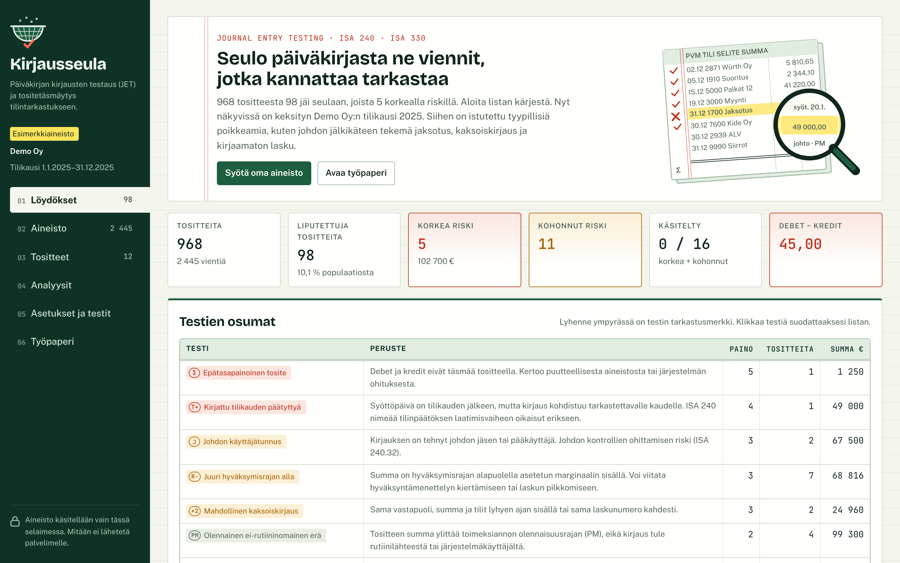
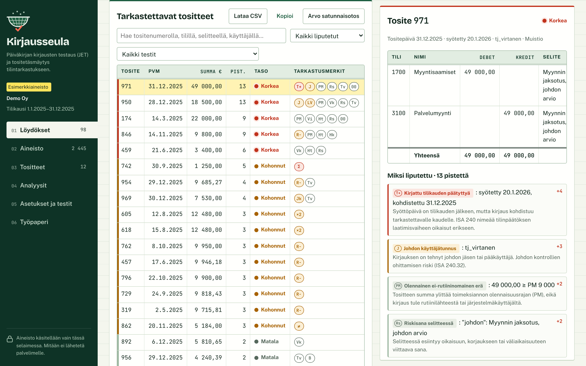

# Kirjausseula

Selaimessa toimiva työkalu päiväkirjan kirjausten testaukseen (journal entry testing, JET) ja tositetäsmäytykseen tilintarkastuksessa. Syötät päiväkirja- tai pääkirjaraportin ja laskut. Työkalu ajaa 19 testiä, pisteyttää jokaisen tositteen ja listaa tarkastettavat kirjaukset riskijärjestyksessä.

**Kokeile:** https://peterkcs.github.io/kirjausseula/ (avautuu esimerkkiaineistolla)

## Miksi

ISA 240 edellyttää, että tilintarkastaja testaa pääkirjaan tehtyjen kirjausten ja tilinpäätöksen laatimisvaiheen oikaisujen asianmukaisuutta johdon kontrollien ohittamisen riskin takia. Käytännössä testaus tehdään usein Excelissä suodattamalla kriteeri kerrallaan. Kirjausseula ajaa samat kriteerit kerralla, yhdistää ne tositekohtaiseksi riskipisteeksi ja kokoaa työpaperiluonnoksen.

## Tietosuoja

Kaikki käsittely tapahtuu käyttäjän selaimessa JavaScriptillä. Aineistoa ei lähetetä palvelimelle, eikä sovelluksella ole taustapalvelua. Tarkastajan merkinnät tallentuvat vain selaimen paikalliseen muistiin (localStorage).

## Syötteet

| Aineisto | Muodot | Huomioita |
|---|---|---|
| Päiväkirja / pääkirja | CSV, TXT, TSV, XLSX, XLS | Yksi rivi = yksi vienti. Sarakkeet tunnistetaan otsikoista (esim. Tosite, Pvm, Syöttöpvm, Tili, Debet, Kredit, Selite, Käyttäjä), ja mappauksen voi korjata. Tukee suomalaista numeromuotoa (1 234,56), päivämääriä 31.12.2025 ja 2025-12-31 sekä Windows-1252-merkistöä. |
| Tositteet | PDF (tekstimuotoinen), Finvoice-XML, TXT, EML | Poimii laskunumeron, laskupäivän, loppusumman, Y-tunnuksen, IBANin ja toimittajan. Skannattuja kuva-PDF:iä ei lueta (ei OCR:ää). |

Pakolliset sarakkeet: tositepäivä, tili ja joko debet/kredit tai etumerkillinen summa. Syöttöpäivä ja käyttäjä kannattaa ottaa mukaan, koska ilman niitä ajoitus- ja käyttäjätestit eivät toimi.

## Testit

Tositteen riskipisteet ovat laukaistujen testien painojen summa. Korkea ≥ 6, kohonnut 3–5, matala 1–2. Painot ja raja-arvot ovat muokattavissa.

| Merkki | Testi | Paino | Peruste |
|---|---|---|---|
| Σ | Epätasapainoinen tosite | 5 | Debet ≠ kredit |
| T+ | Kirjattu tilikauden päätyttyä | 4 | Syöttöpäivä tilikauden jälkeen, tositepäivä tilikaudella |
| J | Johdon käyttäjätunnus | 3 | ISA 240.32, johdon kontrollien ohittaminen |
| R− | Juuri hyväksymisrajan alla | 3 | Summa rajan alla asetetun marginaalin sisällä |
| ×2 | Mahdollinen kaksoiskirjaus | 3 | Sama vastapuoli, summa ja tilit ≤ 14 pv tai sama laskunumero |
| LV | Liikevaihto epätavallista vastatiliä vastaan | 3 | ISA 240.26, tulojen kirjaamisen väärinkäytösriski |
| Jk | Tositteen päiväys eri kaudella kuin kirjaus | 3 | Jaksotus (cut-off) |
| ≠ | Tositteen summa poikkeaa kirjauksesta | 3 | Laskunumero täsmää, summa ei |
| PM | Olennainen ei-rutiininomainen erä | 2 | Summa ≥ PM, ei rutiinilähteestä |
| Vk | Viikonloppu tai pyhäpäivä | 2 | Suomalaiset pyhäpäivät lasketaan vuosittain (pääsiäinen, juhannus, pyhäinpäivä) |
| Vi | Viivästetty tai etupainotteinen kirjaus | 2 | Syöttö- ja tositepäivän ero |
| Ht | Harvoin käytetty tili | 2 | Tili enintään N tositteella |
| Hk | Harvinainen käyttäjä | 2 | Käyttäjä enintään N tositteella |
| Rs | Riskisana selitteessä | 2 | korjaus, oikaisu, väliaikai… (muokattava lista) |
| N# | Sama tositenumero eri päivinä | 2 | Numerointi ei yksiselitteinen |
| Tv | Tilikauden vaihteen kirjaus | 1 | ± N päivää tilikauden päättymisestä |
| 00 | Tasasumma | 1 | Jaollinen asetetulla luvulla |
| ∅ | Puuttuva selite | 1 | Selite alle 3 merkkiä |
| B | Benford-poikkeama | 1 | Kahden ensimmäisen numeron ryhmä yliedustettu, z > 3,29 |

Lisäksi populaatiotasolla:

- debet- ja kredit-summat sekä tilisaldot täsmäytystä varten (aineiston täydellisyys)
- aukot tositenumeroinnissa
- Benfordin laki (1. numero ja 2 ensimmäistä numeroa, MAD ja Nigrinin rajat)
- kirjausten jakauma kuukausittain ja viikonpäivittäin sekä käyttäjäkohtainen yhteenveto

Oletusolennaisuus on 1 % liikevaihdosta kerrottuna 75 %:lla (PM). Selvästi vähäpätöisen raja on 5 % PM:stä. Molemmat kannattaa korvata toimeksiannon omilla luvuilla.

## Tositetäsmäytys

Jokaiselle tositteelle etsitään kirjaus laskunumeron, summan, päiväyksen ja vastapuolen perusteella. Pankkitilejä koskevia suorituksia ei suosita, jotta lasku ei täsmää maksuunsa. Tuloksena on neljä havaintotyyppiä:

- **Täsmätty:** lasku ja kirjaus vastaavat toisiaan.
- **Jaksotusero:** laskun päiväys ja kirjauspäivä ovat eri tilikausilla.
- **Summaero:** laskunumero täsmää, mutta summa ei.
- **Ei kirjausta:** laskulle ei löydy kirjausta, mikä voi tarkoittaa kirjaamatonta velkaa tai tuloa.

Riskitositteista, joille ei löytynyt tositetta, saa valmiin tositepyyntölistan asiakkaalle.

## Tarkastajan työnkulku

1. Syötä päiväkirja ja tarkista sarakkeiden mappaus.
2. Täsmäytä Analyysit-välilehden debet-, kredit- ja tilisaldot pääkirjaan.
3. Aseta tilikausi, PM, hyväksymisraja ja johdon tunnukset Asetuksissa.
4. Syötä laskut ja muut tositteet.
5. Käy läpi korkean ja kohonneen riskin tositteet ja merkitse tila ja huomio.
6. Arvo tarvittaessa satunnaisotos liputtamattomista tositteista (ennakoimattomuus, ISA 240.30 c). Siemenluku kirjataan työpaperiin.
7. Lataa työpaperiluonnos (.txt) ja löydöslista (CSV, puolipiste-erotin, Excel-yhteensopiva).

## Esimerkkiaineisto

Kansiossa `esimerkkiaineisto/` on keksityn Demo Oy:n tilikausi 2025:

- `demo_paivakirja_2025.csv`: noin 970 tositetta ja 2 400 vientiä
- `tositteet/`: 11 PDF-laskua ja yksi Finvoice-XML

Aineistoon on istutettu muun muassa johdon tilikauden jälkeen syöttämä 49 000 euron myynnin jaksotus, kaksoiskirjattu ostolasku, kaksi hyväksymisrajan alittavaa konsulttilaskua, edustuskulu harvinaiselta käyttäjältä, epätasapainoinen tosite, aukko tositenumeroinnissa, jaksotusvirhe, summaero ja kirjaamaton sähkölasku.

## Käyttöönotto

Sovellus on yksi staattinen `index.html`-tiedosto. Kirjastot ladataan cdnjs:stä: SheetJS 0.18.5 Excel-tiedostoille ja pdf.js 3.11.174 PDF-tiedostoille.

- **Paikallisesti:** avaa `index.html` selaimessa.
- **GitHub Pages:** Settings → Pages → Deploy from branch → `main` / root.

## Rajoitukset

- Riskipisteytys on sääntöpohjainen ja painot ovat harkinnanvaraisia. Liputus ei ole havainto, vaan peruste katsoa tositetta tarkemmin.
- Laskujen kenttien poiminta perustuu säännöllisiin lausekkeisiin ja toimii parhaiten suomalaisilla ja englanninkielisillä laskupohjilla.
- Testaus ei korvaa kontrollien ymmärtämistä (ISA 315) eikä tilintarkastajan ammatillista harkintaa.

## Tekijä

Peter Sundberg, KTK (laskentatoimi), KTM-opiskelija, Oulun yliopiston kauppakorkeakoulu.

Lisenssi: MIT
